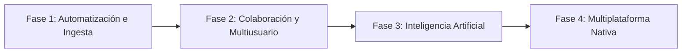

# Hoja de Ruta y Estrategia de Escalabilidad — FinTrack
**Documento Técnico y de Evolución del Producto**  
**Versión:** 1.0 $\rightarrow$ 2.0 (Plan de Escalamiento)  
**Fecha:** Noviembre 2026  

---

## 1. Visión General de Crecimiento

FinTrack ha consolidado una base arquitectónica sólida en su versión 1.0 (React, Tailwind CSS, Supabase PostgreSQL, autenticación y modelos bimonetarios con exportación ejecutiva en Excel).

La siguiente etapa de evolución tiene como objetivo transformar a FinTrack de un **gestor de registro financiero** a un **asistente inteligente de salud patrimonial y automatización financiera**, incrementando el valor percibido por el usuario, reduciendo el esfuerzo de captura de datos y habilitando modelos de monetización sostenibles.



---

## 2. Fases de Escalabilidad Funcional (Roadmap de Producto)

### Fase 1: Automatización e Ingesta Inteligente de Datos (Corto Plazo - 1 a 3 meses)
*Objetivo: Disminuir drásticamente la fricción de entrada de datos manuales sin comprometer la privacidad bancaria.*

1. **Lectura Óptica de Tickets y Facturas (OCR):**
   - Integración de un modelo de visión por computadora (Google Cloud Vision API o Tesseract) para escanear tickets de compra físicos desde la cámara del móvil.
   - Extracción automatizada de: Total, Fecha, Comercio y sugerencia de Categoría según el nombre de la tienda.
2. **Importación Masiva de Extractos Bancarios (CSV / OFX / XML):**
   - Asistente de importación por arrastrar y soltar (*drag & drop*).
   - Mapeo automático de columnas: el usuario sube el estado de cuenta que descarga de su banco (BBVA, Santander, Nu, etc.) y FinTrack importa decenas de movimientos en segundos.
   - Algoritmo de deduplicación para no duplicar movimientos ya registrados previamente.
3. **Transacciones Recurrentes y Suscripciones:**
   - Programación de gastos fijos (renta, servicios, Netflix, Spotify, gimnasio) e ingresos regulares (salario quincenal).
   - Generación automática o notificación con un clic para aprobar movimientos previstos.
4. **Reglas de Categorización Automática:**
   - Motor de coincidencia: si el concepto contiene *"OXXO"* o *"Walmart"*, asignar automáticamente categoría *"Supermercado y Despensa"*.

---

### Fase 2: Finanzas Colaborativas y Multiusuario (Mediano Plazo - 3 a 6 meses)
*Objetivo: Ampliar el alcance de FinTrack a parejas, familias y pequeños equipos de trabajo.*

1. **Espacios Compartidos (*Workspaces* Familiares):**
   - Capacidad de crear un libro contable conjunto (ej. *"Hogar y Familia"*) invitando a miembros mediante correo electrónico.
   - Cuentas compartidas (ej. tarjeta de crédito mancomunada o cuenta corriente familiar) conviviendo con cuentas privadas personales que solo ve su propietario.
2. **Roles y Permisos Granulares:**
   - **Administrador:** Puede crear cuentas, presupuestos y configurar categorías.
   - **Contribuyente:** Puede registrar ingresos y gastos y ver el balance.
   - **Solo Lectura / Auditor:** Útil para hijos menores o asesores contables externos.
3. **División de Gastos (*Split Expenses*):**
   - Calculadora integrada para dividir cuentas compartidas entre amigos o parejas sin requerir apps externas como Splitwise.

---

### Fase 3: Inteligencia Artificial y Salud Financiera Proactiva (6 a 9 meses)
*Objetivo: Convertir los datos históricos en consejos predictivos y toma de decisiones.*

1. **Predicción de Flujo de Efectivo y Cierre de Mes:**
   - Algoritmo que analiza el ritmo de gasto diario de los últimos 90 días y proyecta el balance esperado al final del mes en curso:
     $$\text{Balance Proyectado} = \text{Saldo Actual} + \text{Ingresos Pendientes} - (\text{Tasa de Gasto Promedio Diaria} \times \text{Días Restantes})$$
2. **Detección de Anomalías y Fugas de Capital:**
   - Alertas automáticas: *"Notamos un incremento del 45% en restaurantes esta semana con respecto a tu promedio habitual"*.
   - Identificación de suscripciones duplicadas o aumentos imprevistos de tarifas en servicios contratados.
3. **Asistente Financiero Conversacional (LLM):**
   - Interfaz en lenguaje natural donde el usuario puede consultar:
     - *"¿Cuánto gasté en Uber el mes pasado?"*
     - *"Si quiero ahorrar $10,000 MXN para diciembre, ¿cuánto debo reducir en salidas este mes?"*

---

### Fase 4: Multiplataforma y Distribución en Tiendas Nativas (9 a 12 meses)
*Objetivo: Maximizar el engagement y la presencia en el dispositivo del usuario.*

1. **PWA Avanzada con Notificaciones Web Push:**
   - Notificaciones al móvil al aproximarse a un límite de presupuesto o cuando un pago programado esté por vencer.
2. **App Nativa con React Native / Expo:**
   - Reutilización de la lógica de negocio, hooks y servicios de Supabase.
   - Publicación oficial en Google Play Store y Apple App Store.
   - Integración nativa con Biometría (Face ID / Touch ID / Huella Dactilar) y widgets para la pantalla de inicio del teléfono.

---

## 3. Escalabilidad Técnica y Arquitectura de Sistemas

A medida que el volumen de usuarios y transacciones se multiplique por 10x o 100x, la infraestructura requerirá optimizaciones específicas:

### 3.1. Base de Datos y Rendimiento (PostgreSQL / Supabase)
- **Indexación Compuesta de Alto Rendimiento:**
  Creación de índices compuestos para optimizar consultas frecuentes con filtros múltiples:
  ```sql
  CREATE INDEX idx_movements_user_date ON public.movements (user_id, date DESC);
  CREATE INDEX idx_movements_user_type_cat ON public.movements (user_id, type, category_id);
  ```
- **Particionamiento de Tablas por Rango Temporal:**
  A partir de millones de transacciones, particionar la tabla `movements` por año o trimestre para mantener lecturas y escrituras en milisegundos.
- **Vistas Materializadas para Métricas y Dashboards:**
  Cálculo periódico de KPIs históricos (totales mensuales, acumulados por categoría) para evitar consultas `SUM()` pesadas en tiempo de renderizado.

### 3.2. Sincronización Fuera de Línea Robusta (*Offline-First Engine*)
- Transición del estado local actual hacia un motor de base de datos embebido en el cliente (como **WatermelonDB** o **PowerSync**) con replicación bidireccional basada en CRDTs (*Conflict-Free Replicated Data Types*).
- Esto permitirá registrar transacciones en el metro o en un avión, sincronizando de forma transparente con Supabase al recuperar la señal sin pérdida de información.

### 3.3. Seguridad, Cifrado y Cumplimiento
- **Cifrado en Reposo de Datos Sensibles:**
  Cifrado a nivel de columna para campos como números de cuenta y notas confidenciales utilizando extensiones como `pgcrypto`.
- **Autenticación Multifactor (MFA / 2FA):**
  Soporte para códigos TOTP (Google Authenticator) y llaves de acceso biométricas Passkeys (WebAuthn).
- **Copias de Seguridad Automatizadas y Restauración en Punto en el Tiempo (PITR):**
  Garantizar un RPO (Punto Objetivo de Recuperación) menor a 5 minutos.

---

## 4. Estrategia de Negocio y Modelo de Monetización

Para garantizar la viabilidad y rentabilidad del proyecto a largo plazo, se plantea un esquema **Freemium Ético** alineado con la privacidad:

```
┌────────────────────────────────────────────────────────┐
│                        FINTRACK                        │
├───────────────────────────┬────────────────────────────┤
│         FREE TIER         │          PRO TIER          │
│     (Para todo público)   │     ($3.99 USD / mes)      │
├───────────────────────────┼────────────────────────────┤
│ • Cuentas ilimitadas      │ • Todo lo de Free Tier     │
│ • Movimientos ilimitados  │ • Escaneo OCR de tickets   │
│ • Control bimonetario     │ • Importador de extractos  │
│ • Exportación a Excel/PDF │ • Espacios compartidos     │
│ • Presupuestos básicos    │ • Proyecciones con IA      │
│ • Modo Offline local      │ • Soporte prioritario      │
└───────────────────────────┴────────────────────────────┘
```

### 4.1. Planes Propuestos:
1. **Plan Gratuito (*FinTrack Free*):**
   - Cuentas ilimitadas, movimientos ilimitados, presupuestos básicos y exportación a Excel. Permite captar base instalada de usuarios y viralidad orgánica boca a boca.
2. **Plan Profesional (*FinTrack Pro* - Suscripción mensual/anual):**
   - Escáner de tickets por OCR ilimitado.
   - Importación automática de estados de cuenta en PDF y Excel bancarios.
   - Asistente de inteligencia artificial y proyecciones de ahorro.
   - Reglas avanzadas de categorización automática.
3. **Plan Familiar o Equipos (*FinTrack Family / Teams*):**
   - Hasta 5 miembros en el mismo espacio compartido.
   - Roles administrativos y separación de cuentas personales vs. colectivas.

---

## 5. Cronograma Recomendado de Ejecución

| Hito | Entregables Principales | Duración Estimada |
| :--- | :--- | :---: |
| **Sprint 1 (Corto Plazo)** | Motor de importación masiva de archivos CSV bancarios con mapeo dinámico | 3 - 4 semanas |
| **Sprint 2 (Corto Plazo)** | Módulo de transacciones recurrentes y suscripciones periódicas | 2 - 3 semanas |
| **Sprint 3 (Mediano Plazo)**| Escaneo de tickets físicos mediante Vision OCR | 4 semanas |
| **Sprint 4 (Mediano Plazo)**| Espacios compartidos para parejas y familias (*Workspaces*) | 6 semanas |
| **Sprint 5 (Largo Plazo)**  | Asistente de salud financiera con IA y análisis predictivo | 6 semanas |
| **Sprint 6 (Largo Plazo)**  | Empaquetado y distribución móvil nativa en App Store y Google Play | 8 semanas |

